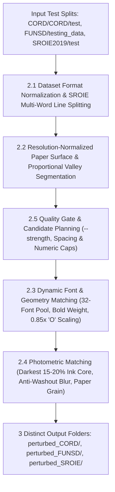

# Channel S3: Algorithmic Glyph-Level Perturbation Module

**Course & Project:** DDA4020 — *Benchmark for Parser Robustness to Visually Subtle Perturbations*  
**Module File:** [`perturbation.py`](perturbation.py)  
**Target Benchmark Datasets:** CORD, SROIE, FUNSD  
**Evaluated Parser Families:** Classical OCR (*Tesseract*), Modular Deep-Learning OCR (*PP-OCR*), and OCR-Free Vision-Language Models (*GLM-OCR*)

---

## 1. Overview & Benchmark Role (Channel S3)

### 1.1 Purpose of Channel S3
In our benchmark taxonomy (aligned with Table 2 of the project proposal), the unperturbed clean baseline is evaluated alongside three orthogonal single-channel perturbations (**S1–S3**) and four multi-channel combinations (**S4–S7**):

| Scenario | Perturbation Channel(s) | Primary Stress Target |
| :--- | :--- | :--- |
| **Baseline** | Clean (Unperturbed) | Unperturbed reference images and ground-truth transcriptions |
| **S1** | Layout Perturbation | Spatial bounding-box geometry, line skew, key-value alignment |
| **S2** | Visual / Photometric Perturbation | Global/local illumination, sensor noise, defocus blur, contrast |
| **S3** | **Glyph-Level Perturbation (This Module)** | **Character-level visual ambiguity (homoglyphs & subtle diacritics)** |
| **S4** | $\text{S1} \oplus \text{S2}$ (Layout + Visual) | Combined geometric layout warps and photometric degradation |
| **S5** | $\text{S1} \oplus \text{S3}$ (Layout + Glyph) | Combined geometric warps and character-level ambiguity |
| **S6** | $\text{S2} \oplus \text{S3}$ (Visual + Glyph) | Combined photometric degradation and character-level ambiguity |
| **S7** | $\text{S1} \oplus \text{S2} \oplus \text{S3}$ (Layout + Visual + Glyph) | Full composite layout, photometric, and glyph-level robustness |

[`perturbation.py`](perturbation.py) implements **Channel S3** as a deterministic, **algorithmic (non-generative) image-space perturbation pipeline**. Given a document image and its word-level bounding polygons/quads, the script segments individual characters within each word, erases selected target characters back to the reconstructed local paper surface, and renders visually ambiguous substitute glyphs (1-to-1 homoglyphs or single-mark diacritics) at the **exact original character positions**.

Crucially, **the unperturbed transcription is preserved as the ground-truth reference label** (`text` and `original_text`), while the visually rendered character modifications are logged separately (`perturbed_text` and `perturbations`). When humans read receipts or scanned forms, lexical and contextual priors allow effortless recovery of the intended token (e.g., reading `Totâl` as `Total`, `B0LOGNASE` as `BOLOGNASE`, or `58,O00` as `58,000`). Evaluating parser outputs against the original ground truth therefore quantifies whether a document parser exhibits context-aware resilience or suffers brittle character/token errors (`ΔCER`, `ΔWER`, and downstream entity extraction F1 drop).

---

### 1.2 Channel-Isolation Requirement (Preventing S1 & S2 Leakage)
A core methodological requirement of our benchmark is **strict channel isolation**: when running Channel S3 alone (or attributing marginal degradation in composite scenarios S5–S7), the glyph perturbation operator must not leak Layout (S1) geometric shifts or Visual (S2) photometric artifacts.

1. **Preventing Layout (S1) Leakage via Strict Bounding-Box & Baseline Containment:**
   - Every substituted homoglyph is rendered on an $8\times$ supersampled canvas, cropped tightly to its active ink bounds, scaled to fit strictly within the original character's tight ink bounding box $[x_1, x_2] \times [y_1, y_2]$, and anchored directly to the original character baseline $y_2$.
   - Horizontal edits are confined within valley-snapped character slots $[s_{x1}, s_{x2}]$ with a 1 px boundary taper (`confinement`), ensuring that neighboring characters, inter-character kerning, word widths, and line heights **never shift by even a single pixel**.
   - For diacritics, the pipeline inspects the pixel strip above the character for ink from the preceding line and constrains the accent mark inside the available vertical headroom (compressing the base glyph slightly downward toward its baseline only when upper clearance is tight).

2. **Preventing Visual (S2) Leakage via Local Photometric & Degradation Matching:**
   - Naive digital text rendering (e.g., drawing pure `#000000` black vector fonts over a solid white rectangle) introduces sharp high-frequency step edges and stark luminance patches. In paired image-similarity vs. parser-error analysis (`PSNR`, `SSIM`, `FSIM` vs. `ΔCER`, `ΔWER`), such digital seams act as uncalibrated S2 visual noise and confound error attribution.
   - To prevent S2 leakage, [`perturbation.py`](perturbation.py) reconstructs the continuous ink-free paper surface via normalized Gaussian convolution (leaving zero rectangular patches) and matches every rendered glyph to the surrounding unperturbed capture across three local photometric dimensions:
     1. **Core-Pixel Ink Color Sampling:** Extracted from the darkest 15–20% of foreground stroke core pixels in neighboring unperturbed characters (never `#000000` and never washed out by anti-aliased border pixels).
     2. **Stroke-Proportional Optical Blur ($\sigma \in [0.38, 1.30]$):** Matched to the contrast-normalized Sobel gradient and Laplacian edge softness of adjacent unperturbed characters while preserving the solid dark ink spine.
     3. **Local High-Frequency Sensor/Paper Grain:** Sampled from local background residuals and blended into both the erased paper surface and the rendered ink strokes.

---

### 1.3 Architectural Failure Hypothesis Under Isolated Channel S3
Because Channel S3 modifies fine-grained sub-word glyph cues without altering layout geometry or global image quality, it isolates distinct architectural failure mechanisms across our three evaluated parser families (matching Section 3.3 of the proposal):

- **Classical OCR (*Tesseract*):** Relies on adaptive thresholding, connected-component contour extraction, and character-template/LSTM recognition with limited domain-specific lexical priors on receipt items and prices. Alphanumeric homoglyph swaps (`O` $\leftrightarrow$ `0`, `B` $\leftrightarrow$ `8`, `S`/`s` $\leftrightarrow$ `5`, `Z`/`z` $\leftrightarrow$ `2`, `1` $\leftrightarrow$ `I`/`l`) directly flip top-1 character posteriors, while single-mark diacritics (`é/É`, `â/Â`, `ç/Ç`) alter connected-component aspect ratios or split contours, producing localized character substitutions/insertions where `ΔCER` scales linearly with perturbation strength.
- **Modular Deep-Learning OCR (*PP-OCR*):** Operates as a three-stage cascaded pipeline consisting of a **Differentiable Binarization (DB) text detector**, a **direction classifier**, and a **CRNN text recognizer** (trained with CTC decoding). Because Channel S3 preserves exact word bounding boxes, text orientation, and local stroke contrast, both the DB detector boxes and direction classifier predictions remain stable (validating zero S1/S2 leakage). Inside the CRNN recognition head, however, frame-level visual features are decoded quasi-independently under CTC: alphanumeric lookalikes inside numeric tokens (`25.000` $\rightarrow$ `25.00O`) and accented uppercase/lowercase letters map to visually confusable or out-of-vocabulary character tokens without semantic correction.
- **OCR-Free Vision-Language Models (*GLM-OCR*):** Couples a **0.4B CogViT visual encoder** directly with an autoregressive **0.5B GLM language decoder**. While the 0.5B GLM language decoder leverages strong lexical priors to auto-correct common English words (e.g., recovering `Change` from `Çhange` or `Service` from `Servicé`), the 0.4B CogViT visual patch embeddings are sensitive to homoglyphs and diacritics on out-of-vocabulary merchant headers, Indonesian/regional menu items (in CORD, e.g., `Keaw` $\rightarrow$ `Keàw`), and numeric totals—occasionally triggering autoregressive token drift or hallucinated digit sequences.

---

## 2. Methodology: How the Script Works



### 2.1 Multi-Dataset Test-Split Normalization (CORD, FUNSD, SROIE)
All evaluation in our benchmark is conducted strictly on the **official test splits** across all three datasets, writing outputs into **three distinct folders**:

| Dataset | Test Split Input Path | Test Documents | Native Annotation Format | Distinct Output Folders (`medium` / `low` / `high`) |
| :--- | :--- | :---: | :--- | :--- |
| **CORD** | `CORD/CORD/test` (`image/`, `json/`) | 100 | Word-level 4-point `quad` entries inside `valid_line` | `perturbed_CORD/`, `perturbed_CORD_low/`, `perturbed_CORD_high/` |
| **FUNSD** | `FUNSD/testing_data` (`images/`, `annotations/`) | 50 | Semantic `form` entities (`question`, `answer`, `header`, `other`) with word-level `[x1, y1, x2, y2]` `box` arrays | `perturbed_FUNSD/`, `perturbed_FUNSD_low/`, `perturbed_FUNSD_high/` |
| **SROIE** | `SROIE2019/test` (`img/`, `box/`, `entities/`) | 347 | Line-level 8-coordinate `x1,y1,x2,y2,x3,y3,x4,y4,text` `.txt` files + key-value `entities/*.txt` JSONs | `perturbed_SROIE/`, `perturbed_SROIE_low/`, `perturbed_SROIE_high/` |

- **FUNSD Word-Box Adapter (`load_funsd_annotation`):** Normalizes each word's `[x1, y1, x2, y2]` bounding box inside `form[i]["words"]` into a 4-point `quad` in-place while preserving the native `form` hierarchy (`box`, `text`, `label`, `words`, `linking`, `id`). Perturbed words and parent `form` entities retain their unperturbed ground-truth `"text"` alongside `"original_text"`, `"perturbed_text"`, and `"perturbations"`.
- **SROIE Line-to-Word Valley Splitter (`load_sroie_annotation`, `split_line_into_word_quads`):** Because SROIE `box/*.txt` annotations provide line-level 8-coordinate quads containing multiple space-separated words (e.g., `OJC MARKETING SDN BHD`), `split_line_into_word_quads` segments each multi-word line into tight word-level bounding quads by snapping nominal typographic word + whitespace boundaries to vertical ink-projection valleys and trimming empty margins. This ensures per-word constraints ($\le 1$ diacritic per word, $\le 1$ digit edit per numeric token) and word-ROI similarity metrics operate at true word granularity. Both unified `json/test_<id>_perturbed.json` and native `box/` + `entities/` files are written to `perturbed_SROIE/`.

### 2.2 Background Erasure & Reconstruction
1. **Resolution-Normalized Continuous Paper Surface Estimation ([`estimate_paper_surface`](perturbation.py#L628-L670)):**
   - Given input image $I \in \mathbb{R}^{H \times W \times 3}$, if $\max(H, W) > 1024$ (e.g., 4K $2304 \times 4096$ camera captures such as `receipt_00494` where character strokes are $12\text{–}16\text{ px}$ wide), the image is first downsampled via area interpolation to a canonical working scale ($\max(H_{\text{work}}, W_{\text{work}}) = 1024$). This guarantees that the subsequent $11 \times 11$ elliptical morphological dilation completely bridges across thick ink strokes rather than misclassifying dark stroke interiors as paper.
   - A $3 \times 3$ median filter followed by $11 \times 11$ elliptical dilation computes the local upper luminance envelope $D_{\text{gray}}$.
   - Pixels satisfying $D_{\text{gray}} - I_{\text{gray}} < 10.0$ are identified as uninked paper, eroded by $3 \times 3$ to exclude anti-aliased ink halos, and assigned confidence weights $W(x, y) \in \{0.02, 1.0\}$.
   - Normalized Gaussian convolution ($21 \times 21$ kernel, $\sigma = 5.0$) smoothly interpolates the 2D paper color surface underneath ink strokes while preserving natural lighting gradients and paper tint, and is upsampled back to $(H, W)$ when $\max(H, W) > 1024$:
     $$P_{\text{surface}} = \frac{G_{\sigma=5} * (I \cdot W)}{\max(G_{\sigma=5} * W,\, 10^{-4})}$$

2. **Proportional-Aware Valley Segmentation ([`get_char_boxes_for_word`](perturbation.py#L202-L267)):**
   - For each word crop of length $n$, local ink depth $d(x,y) = \max(0, P_{\text{gray}}(x,y) - I_{\text{gray}}(x,y))$ is normalized by its 97th percentile $d_{97}$ into a foreground ink map $M_{\text{ink}}(x,y) \in [0, 1]$.
   - Rather than slicing words into uniform $W/n$ intervals (which cuts through wide characters like `M, W, 0, 8` or misses narrow characters like `1, l, I, ,`), each character $c_k$ is assigned a typographic width weight $w_k \in \{0.56, 1.00, 1.16\}$.
   - Nominal boundaries $x_i^{\text{nom}} = W \cdot \frac{\sum_{k < i} w_k}{\sum_{k=0}^{n-1} w_k}$ are snapped to the local minimum of the 3-tap smoothed vertical column-ink projection $\sum_y M_{\text{ink}}(x,y)$ within radius $r = \max(2, \lfloor 0.42 \cdot \bar{w} \rfloor)$.
   - Thresholding $M_{\text{ink}} > 0.25$ inside each valley slot $[s_{x1}, s_{x2}]$ yields the tight character ink box $[x_1, x_2] \times [y_1, y_2]$.

3. **Ghost-Free Foreground Erasure ([`perturbation.py`](perturbation.py#L1626-L1664)):**
   - Inside the target character slot $[s_{x1}, s_{x2}] \times [y_{w1}-2, y_{w2}+2]$, local ink difference $d_{\text{roi}} = \max(0, P_{\text{gray}} - I_{\text{gray}})$ is normalized against the 85th percentile of active ink pixels $d_{85} = P_{85}(d_{\text{roi}}[d_{\text{roi}} > 5.0])$:
     $$\alpha_{\text{erase}}^{(0)} = \text{clip}\!\left(\frac{d_{\text{roi}} - 2.5}{\max(5.5,\, 0.36\,d_{85})}, \; 0.0, \; 1.0\right)$$
   - Blending $0.65 \cdot \text{dilate}_{3\times 3}(\alpha_{\text{erase}}^{(0)}) + 0.35 \cdot \alpha_{\text{erase}}^{(0)}$, tapering the leftmost and rightmost slot columns by $0.35$, and smoothing with a $3\times 3$ Gaussian ($\sigma = 0.65$) completely removes the original glyph (including faint anti-aliased fringes) onto $P_{\text{surface}} + \text{grain}_{\text{local}}$ without disturbing adjacent characters or creating rectangular seams.

---

### 2.3 Dynamic Font & Geometry Matching
1. **Multi-Style & Multi-Weight Font Pool ([`AdaptiveFontPool`](perturbation.py#L365-L521)):**
   At initialization, [`AdaptiveFontPool`](perturbation.py#L408-L521) loads **32 TrueType font/weight variants** across four document typography families—including Light, Regular, SemiBold, and Bold weights—and pre-computes per-glyph intrinsic aspect ratios and normalized stroke-to-height ratios:
   - **Condensed Sans-Serif (`condensed_sans`, thermal receipts):** Arial Narrow (`Regular`, `Bold`) and Bahnschrift Variable (`Light Condensed`, `SemiLight Condensed`, `Condensed`, `SemiCondensed`, `SemiBold Condensed`, `SemiBold SemiCondensed`, `Bold Condensed`, `Bold SemiCondensed`).
   - **Standard Sans-Serif (`standard_sans`, general receipts & forms):** Segoe UI (`Light`, `SemiLight`, `Regular`, `Bold`), Calibri (`Light`, `Regular`, `Bold`), Arial (`Regular`, `Bold`), Tahoma (`Regular`, `Bold`), and Verdana (`Regular`, `Bold`).
   - **Monospace / Dot-Matrix (`monospace`, cash registers & fixed-pitch print):** Courier New (`Regular`, `Bold`), Consolas (`Regular`, `Bold`), and Lucida Console (`Regular`).
   - **Serif (`serif`, scanned administrative/financial forms):** Times New Roman (`Regular`, `Bold`) and Georgia (`Regular`, `Bold`).

2. **Stroke Thickness, Font Weight & Style Estimation ([`estimate_char_stroke_and_aspect`](perturbation.py#L533-L619)):**
   - Each character's ink map is binarized at its half-maximum core threshold $T = \max(0.40,\, 0.52 \cdot \max(M_{\text{ink}}))$. Local stroke thickness $s_{\text{px}}$ is fused from three geometric estimators:
     1. **Euclidean Distance Transform ($s_{\text{DT}}$):** $2.0 \times P_{60}(\text{EDT}(B_{\text{core}}))$.
     2. **Scanline Run-Length ($s_{\text{RL}}$):** 40th percentile of contiguous foreground run lengths across horizontal and vertical scanlines through $B_{\text{core}}$.
     3. **Area-to-Perimeter Ratio ($s_{\text{AP}}$):** $\frac{2 \cdot \text{Area}(B_{\text{core}})}{\text{Perimeter}(B_{\text{core}})}$.
     $$s_{\text{px}} = \text{clip}\!\left(0.40\,s_{\text{DT}} + 0.35\,s_{\text{RL}} + 0.25\,s_{\text{AP}}, \; 1.0, \; \max(1.8, \min(0.42\,w, 0.28\,h))\right)$$
   - Word-level typography cues (`estimate_word_geometry_profile`) classify the word style (`monospace` if slot-width CV $< 0.10$; `serif` if stem terminal flare $> 1.52$; `condensed_sans` if median aspect ratio $< 0.56$; otherwise `standard_sans`) and detect dot-matrix print (`is_dot_matrix = True` when active-ink Laplacian median $> 0.55$ and $s_{\text{px}} < 2.5$).
   - **Dynamic Bold Weight Selection ([`select_font`](perturbation.py#L474-L521)):** When a character's estimated stroke exceeds the regular-weight threshold ($\hat{\tau} = s_{\text{px}}/h \ge 0.125$ or $s_{\text{px}} \ge 2.15\text{ px}$), `select_font` applies a weight-mismatch penalty against thin/regular fonts (`weight < 600`) so Bold font variants are dynamically chosen to match thick receipt headers and bold totals. Conversely, bold fonts are penalized on thin strokes.

3. **Strict Bounding-Box Clamping, Condensed `0` $\rightarrow$ `O` Scaling & Collision-Aware Diacritics:**
   - **Homoglyph Clamping ([`render_adaptive_homoglyph`](perturbation.py#L1050-L1178)):** Rendered at $8\times$ supersampling, cropped to active ink, scaled to height $8h$, fine-tuned via supersampled morphological dilation (up to $k=7$ for heavy bold print) or erosion if stroke thickness deviates from $8 \cdot s_{\text{px}}$, anchored to the original baseline $y_2$, and downsampled via `cv2.INTER_AREA`.
   - **Condensed `0` $\rightarrow$ `O` Width Scaling ([`perturbation.py`](perturbation.py#L1063-L1112)):** Because uppercase `O` (`\u004f` / `\u041e`) is naturally wider than numeric `0` on receipts, substituting `0` $\rightarrow$ `O` applies a **`0.85x` horizontal width scale factor** so the replacement matches narrow digit proportions without crowding adjacent digits.
   - **Collision-Aware Diacritics ([`create_adaptive_diacritic_alpha`](perturbation.py#L1181-L1281)):** Scans $[y_1 - \text{pad}_{\text{top}},\, y_1 - 2]$ for ink from the line above; if headroom is tight ($< \max(3, \lfloor 0.22\,h \rfloor)$), the base character is compressed $15\%$ downward toward its baseline $y_2$ so the accent mark ($\le 0.44\,w$ wide, stroke $0.82 \cdot s_{\text{px}}$) fits strictly inside the line height without colliding with upper text.

---

### 2.4 Photometric & Capture-Degradation Matching
1. **Core-Pixel Foreground Ink Sampling ([`_extract_core_ink_pixels`](perturbation.py#L798-L820), [`sample_local_ink_color`](perturbation.py#L823-L913)):**
   - Rather than taking the median across all foreground mask pixels (where light anti-aliased edge pixels dilute dark ink into pale gray), `_extract_core_ink_pixels` erodes the foreground mask (`2x2` kernel) and filters for the **darkest 15–20% of pixels by luminance** (`luma <= np.percentile(luma, 18)`) across unperturbed characters in the same word (with fallback to the same line).
   - Extracts local median core BGR color $\mathbf{c}_{\text{med}}$, spine color $\mathbf{c}_{\text{core}}$ ($P_{20}$), soft edge color $\mathbf{c}_{\text{edge}}$ ($P_{75}$), and peak opacity $\alpha_{\text{peak}} \in [0.86, 0.98]$.
   - **Strict Non-Black Guarantee:** Every BGR channel is clamped to $\ge 10.0$, guaranteeing `#000000` is never rendered.

2. **Stroke-Proportional Anti-Washout Blur ([`estimate_local_blur_sigma`](perturbation.py#L916-L955), [`feather_and_texture_alpha`](perturbation.py#L991-L1021)):**
   - Measures the 85th percentile of contrast-normalized $3\times 3$ Sobel gradient and Laplacian magnitude over the edge transition band ($0.12 \le M_{\text{ink}} \le 0.88$) of neighboring unperturbed characters to estimate local capture softness $\sigma_{\text{blur}} \in [0.40, 1.50]$.
   - **Anti-Washout Stroke Scaling:** To prevent Gaussian blur from washing out thin strokes into pale gray, `feather_and_texture_alpha` caps effective blur proportionally to rendered stroke width ($\sigma_{\text{eff}} \le 0.52$ when $s_{\text{px}} \le 1.55\text{ px}$, scaling up to $\min(1.30, 0.38 \cdot s_{\text{px}})$ on thicker strokes) and normalizes the blurred mask by the **85th percentile of active stroke pixels**, preserving a solid $\alpha_{\text{peak}}$ core plateau while softening outer edges.

3. **High-Frequency Texture & Grain Blending ([`sample_local_high_freq_grain`](perturbation.py#L958-L988), [`compose_ink_layer`](perturbation.py#L1284-L1301)):**
   - Extracts local background high-frequency residuals $R_{\text{HF}} = I_{\text{word}} - G_{\sigma=1.0}(I_{\text{word}})$ and blends $60\%$ real shifted residual patches with $40\%$ channel-matched Gaussian noise $\mathcal{N}(0, \boldsymbol{\sigma}_{\text{grain}}^2)$.
   - Modulates interior glyph opacity by $\pm 8\%$ luminance grain and adds $0.55 \cdot \text{grain}_{\text{local}}$ to the ink fill before alpha-compositing over the reconstructed paper surface.

---

### 2.5 Substitution Taxonomy & Spatial Constraints
To guarantee that **every single perturbation produces a genuine visual glyph modification in pixel space**:
- Jarring topological symbol morphs (such as `5` $\rightarrow$ `$` or `9` $\rightarrow$ `g`/`q`) are strictly excluded.
- **Identical-outline cross-script swaps (e.g., Latin `a`/`C` $\rightarrow$ Cyrillic `а`/`С`) are explicitly excluded (`CROSS_SCRIPT_HOMOGLYPH_MAP = {}`).** While cross-script Unicode swaps are used in text-space attacks, TrueType fonts use the exact same glyph outlines for Latin `a, e, o, c, C, T, ...` and Cyrillic `а, е, о, с, С, Т, ...`—meaning rendering them into an image merely erases a letter and redraws the identical letter shape (a visual no-op that wastes the document's perturbation budget).

Substitutions are restricted to two visually distinct, controlled categories ([`perturbation.py`](perturbation.py#L278-L320)):

1. **Category A — Visually Distinct 1-to-1 Alphanumeric & Case Homoglyphs (`HOMOGLYPH_MAP`):**
   Every homoglyph mapping swaps between two visually confusable but geometrically distinct character shapes (rendered in matching `condensed_sans`, `standard_sans`, or `monospace` styles; slashed-zero Consolas is excluded when rendering `0`):
   - `0` $\leftrightarrow$ `O`, and `o` $\rightarrow$ `0` *(with `0.85x` horizontal width scaling for `0` $\rightarrow$ `O`)*
   - `1` $\rightarrow$ `{I, l}`, `I` $\rightarrow$ `1`, `l` $\rightarrow$ `1` *(always swaps between a hooked/serifed digit `1` and a straight vertical stem `I`/`l`, avoiding `I` $\leftrightarrow$ `l` which look identical in sans-serif fonts)*
   - `5` $\leftrightarrow$ `S`, and `s` $\rightarrow$ `5`
   - `8` $\leftrightarrow$ `B`
   - `2` $\leftrightarrow$ `Z`, and `z` $\rightarrow$ `2`

2. **Category B — Subtle Single-Mark Diacritics Across Lowercase & Uppercase (`DIACRITIC_CHAR_MAP`):**
   Includes both lowercase and uppercase base letters so that ALL-CAPS receipt items, Title-Case headers (e.g., `Change` $\rightarrow$ `Çhange`), and lowercase text all receive genuine visual accent marks:
   - `e` / `E` $\rightarrow$ `é, è, ë` / `É, È, Ë` (`acute`, `grave`, `diaeresis`)
   - `a` / `A` $\rightarrow$ `à, á, â` / `À, Á, Â` (`grave`, `acute`, `circumflex`)
   - `o` / `O` $\rightarrow$ `ó, ò` / `Ó, Ò` (`acute`, `grave`)
   - `u` / `U` $\rightarrow$ `ú, ù` / `Ú, Ù` (`acute`, `grave`)
   - `i` / `I` $\rightarrow$ `í, ì` / `Í, Ì` (`acute`, `grave`)
   - `c` / `C` $\rightarrow$ `ç` / `Ç` (`cedilla`)

3. **Spatial Density & Capture-Quality Constraints ([`perturbation.py`](perturbation.py#L742-L799), [`perturbation.py`](perturbation.py#L1515-L1545)):**
   - **Non-Adjacent Spacing Rule (`|i - j| > 1`):** Never perturbs two adjacent characters in the same word.
   - **Per-Word Diacritic Cap ($\le 1$ per word):** At most one character per word may receive a Category B diacritic mark.
   - **Single-Digit Cap per Numeric Token ($\le 1$ digit edit per word):** Multi-digit numbers and prices (`has_digit_edit_already`) receive at most **one** substituted digit per token so numeric strings never suffer multi-digit corruption.
   - **Shadow & Crease Quality Gate (`check_capture_quality_gate`):** Automatically skips character boxes sitting on heavy shadows ($\text{median}(P_{\text{gray}}) < 75$), sharp paper creases/folds ($\sigma(P_{\text{gray}}) > 16.0$ or $P_{95}-P_5 > 36.0$), or unstable/faded ink (contrast $< 16.0$).

---

### 2.6 Perturbation Strength Levels (`--strength`) & Full Test-Split Empirical Metrics
The `--strength` flag controls the target fraction $\rho$ of **eligible characters** (characters in `HOMOGLYPH_MAP` or `DIACRITIC_CHAR_MAP` passing `check_capture_quality_gate`) perturbed per document ($K = \text{round}(\rho \cdot N_{\text{eligible}})$). All three strength tiers (`low`, `medium`, `high`) have been evaluated across all **497 official test documents** (`100` CORD + `50` FUNSD + `347` SROIE).

#### 1. Dose-Response Summary Across `--strength` Tiers (All 3 Datasets Combined, 497 Test Documents)
| `--strength` Tier | Target Fraction ($\rho$) | Total Perturbed Words | Total Character Edits / Eligible | Empirical Rate | Mean Full-Image PSNR (dB) | Mean Full-Image SSIM | Mean Full-Image FSIM | Mean Word-ROI PSNR (dB) | Mean Word-ROI SSIM | Mean Word-ROI FSIM |
| :--- | :---: | :---: | :---: | :---: | :---: | :---: | :---: | :---: | :---: | :---: |
| **`low`** | **10%** (`0.10`) | 10,043 | 10,442 / 104,404 | **10.00%** (`9.97–10.01%`) | **38.06 dB** (`36.16–45.04 dB`) | **0.9977** (`0.9973–0.9988`) | **0.9988** (`0.9986–0.9992`) | **27.42 dB** (`23.05–28.98 dB`) | **0.9298** (`0.9265–0.9395`) | **0.9489** (`0.9485–0.9501`) |
| **`medium`** *(default)* | **20%** (`0.20`) | 19,157 | 20,865 / 104,404 | **19.99%** (`19.94–20.03%`) | **34.98 dB** (`33.06–41.89 dB`) | **0.9953** (`0.9946–0.9977`) | **0.9976** (`0.9973–0.9983`) | **27.18 dB** (`22.48–28.97 dB`) | **0.9252** (`0.9239–0.9356`) | **0.9454** (`0.9443–0.9487`) |
| **`high`** | **35%** (`0.35`) | 30,638 | 36,514 / 104,404 | **34.97%** (`34.87–35.00%`) | **32.44 dB** (`30.51–39.39 dB`) | **0.9918** (`0.9904–0.9960`) | **0.9958** (`0.9952–0.9971`) | **26.20 dB** (`21.61–28.14 dB`) | **0.9112** (`0.9046–0.9235`) | **0.9362** (`0.9356–0.9379`) |

#### 2. Per-Dataset Test-Split Breakdown across `--strength` Tiers (`low`, `medium`, `high`)
| Strength Tier | Dataset | Output Folder | Test Docs ($N$) | Perturbed Words ($W$) | Character Edits / Eligible | Empirical Rate | Mean Full-Image PSNR (dB) | Mean Full-Image SSIM | Mean Full-Image FSIM | Mean Word-ROI PSNR (dB) | Mean Word-ROI SSIM | Mean Word-ROI FSIM |
| :--- | :--- | :--- | :---: | :---: | :---: | :---: | :---: | :---: | :---: | :---: | :---: | :---: |
| **`low` (10%)** | **CORD** | `perturbed_CORD_low/` | 100 | 600 | 615 / 6,157 | **9.99%** | 45.04 dB | 0.9988 | 0.9991 | 28.98 dB | 0.9265 | 0.9501 |
| **`low` (10%)** | **FUNSD** | `perturbed_FUNSD_low/` | 50 | 1,715 | 1,801 / 18,065 | **9.97%** | 36.16 dB | 0.9980 | 0.9992 | 23.05 dB | 0.9395 | 0.9495 |
| **`low` (10%)** | **SROIE** | `perturbed_SROIE_low/` | 347 | 7,728 | 8,026 / 80,182 | **10.01%** | 36.33 dB | 0.9973 | 0.9986 | 27.60 dB | 0.9294 | 0.9485 |
| **`low` (10%)** | **Weighted Avg** | *All 497 Docs* | **497** | **10,043** | **10,442 / 104,404** | **10.00%** | **38.06 dB** | **0.9977** | **0.9988** | **27.42 dB** *(26.91 dB word-wt)* | **0.9298** *(0.9309 word-wt)* | **0.9489** *(0.9488 word-wt)* |
| **`low` (10%)** | **Macro Avg** | *Equal Dataset Weight* | — | — | — | **9.99%** | **39.18 dB** | **0.9980** | **0.9990** | **26.55 dB** | **0.9318** | **0.9494** |
| **`medium` (20%)** | **CORD** | `perturbed_CORD/` | 100 | 1,153 | 1,233 / 6,157 | **20.03%** | 41.89 dB | 0.9977 | 0.9983 | 28.97 dB | 0.9239 | 0.9487 |
| **`medium` (20%)** | **FUNSD** | `perturbed_FUNSD/` | 50 | 3,253 | 3,602 / 18,065 | **19.94%** | 33.06 dB | 0.9960 | 0.9983 | 22.48 dB | 0.9356 | 0.9464 |
| **`medium` (20%)** | **SROIE** | `perturbed_SROIE/` | 347 | 14,751 | 16,030 / 80,182 | **19.99%** | 33.27 dB | 0.9946 | 0.9973 | 27.34 dB | 0.9240 | 0.9443 |
| **`medium` (20%)** | **Weighted Avg** | *All 497 Docs* | **497** | **19,157** | **20,865 / 104,404** | **19.99%** | **34.98 dB** | **0.9953** | **0.9976** | **27.18 dB** *(26.62 dB word-wt)* | **0.9252** *(0.9260 word-wt)* | **0.9454** *(0.9449 word-wt)* |
| **`medium` (20%)** | **Macro Avg** | *Equal Dataset Weight* | — | — | — | **19.99%** | **36.07 dB** | **0.9961** | **0.9980** | **26.26 dB** | **0.9279** | **0.9465** |
| **`high` (35%)** | **CORD** | `perturbed_CORD_high/` | 100 | 1,822 | 2,147 / 6,157 | **34.87%** | 39.39 dB | 0.9960 | 0.9971 | 28.14 dB | 0.9046 | 0.9379 |
| **`high` (35%)** | **FUNSD** | `perturbed_FUNSD_high/` | 50 | 5,163 | 6,306 / 18,065 | **34.91%** | 30.51 dB | 0.9929 | 0.9971 | 21.61 dB | 0.9235 | 0.9375 |
| **`high` (35%)** | **SROIE** | `perturbed_SROIE_high/` | 347 | 23,653 | 28,061 / 80,182 | **35.00%** | 30.72 dB | 0.9904 | 0.9952 | 26.30 dB | 0.9113 | 0.9356 |
| **`high` (35%)** | **Weighted Avg** | *All 497 Docs* | **497** | **30,638** | **36,514 / 104,404** | **34.97%** | **32.44 dB** | **0.9918** | **0.9958** | **26.20 dB** *(25.62 dB word-wt)* | **0.9112** *(0.9130 word-wt)* | **0.9362** *(0.9360 word-wt)* |
| **`high` (35%)** | **Macro Avg** | *Equal Dataset Weight* | — | — | — | **34.93%** | **33.54 dB** | **0.9931** | **0.9965** | **25.35 dB** | **0.9132** | **0.9370** |

---

## 3. What It Achieves: Quality Assessment & Limitations ("Is It Good Enough, and If Not, Why?")

### 3.1 What Works Well (Why It Is Sufficient for the Benchmark)
1. **Visually Subtle at Normal Viewing Distance Across Diverse Captures:**
   Across faded thermal receipts, high-resolution mobile camera photos (`2304 x 4096`), dot-matrix printouts, and scanned forms, the combination of resolution-normalized Gaussian paper reconstruction, darkest-core ink sampling, and anti-washout blur blends substituted glyphs into the surrounding word without the stark black-on-white "digital stamp" appearance of naive rendering.
2. **100% Genuine Visual Edits Across Both ALL-CAPS Text & Prices (Zero Visual No-Ops):**
   By eliminating identical-outline cross-script Cyrillic swaps (`a->а`, `C->С`) and pairing visually distinct alphanumeric homoglyphs (`0` $\leftrightarrow$ `O`, `1` $\leftrightarrow$ `I`/`l`, `5` $\leftrightarrow$ `S`/`s`, `8` $\leftrightarrow$ `B`, `2` $\leftrightarrow$ `Z`/`z`) with lowercase + uppercase single-mark diacritics (`é/É, à/À, ç/Ç, ...`), the $\le 1$ digit-per-token cap, and `0.85x` horizontal `O` scaling, every scheduled edit produces a verifiable visual glyph change distributed evenly across text and numbers.
3. **Zero Global Pixel Drift & Clean Metric Baselines:**
   Because edits are strictly localized to individual character slots $[s_{x1}, s_{x2}]$ while 100% of unperturbed background and text pixels remain untouched, full-image structural similarity stays above **>0.993 SSIM/FSIM** across CORD, FUNSD, and SROIE. Consequently, any increase in `ΔCER` or `ΔWER` is provably caused by localized glyph ambiguity rather than global image degradation.
4. **Clear Monotonic Separation for Cross-Architecture Comparison:**
   The `low` (10%), `medium` (20%), and `high` (35%) strength tiers produce a controlled, reproducible dose-response curve that cleanly separates character-template sensitivity (*Tesseract*), DB detector stability vs. CRNN/CTC frame-level confusability (*PP-OCR*), and 0.4B CogViT visual encoding vs. 0.5B GLM language-prior effects (*GLM-OCR*).

---

### 3.2 Where It Falls Short (Known Limitations & Why)
While the output is visually cohesive at normal document viewing scale, close inspection under $4\times$ macro zoom (`--debug` crops) reveals four inherent limitations of a purely algorithmic, system-font pipeline:

1. **Bowl Geometry Mismatches on Circular `O` vs. Narrow Receipt `0`:**
   - *Observation:* Even after applying the `0.85x` horizontal width scale factor and selecting condensed sans-serif fonts (`Arial Narrow`, `Bahnschrift Condensed`), standard TrueType uppercase `O` glyphs have a more rounded elliptical counter (interior hole) than custom flat-sided thermal printer `0` digits. Under close zoom, a substituted `O` inside a price string (e.g., `20,O00`) can still look slightly rounder than its neighboring `0`s.
   - *Why:* System TrueType fonts do not include proprietary thermal-printer dot/clipper ROM typefaces.
2. **Stroke-Profile Differences on Heavy Thermally Bled Headers:**
   - *Observation:* Dynamically selecting Bold font variants (`weight >= 600`) and applying supersampled morphological dilation (up to $k=7$) solves thin-stroke washout on bold text. However, on heavily bled merchant logos or over-heated thermal headers where physical ink spread rounds out corners and fills interior counters, a TrueType bold replacement glyph has cleaner internal geometry than the thermally bled characters beside it.
   - *Why:* Isotropic morphological dilation thickens strokes uniformly but only approximates physical thermal head heat-bleed anisotropy.
3. **Proportional Valley Segmentation on Touching or Heavily Blurred Characters:**
   - *Observation:* When severe defocus blur or heavy ink bleed fuses two adjacent characters into a single connected component with no vertical projection valley, the proportional width heuristic must place a cut across the ligature bridge. Erasing the target character can occasionally clip 1 px of the neighbor's touching stroke edge.
   - *Why:* Dataset annotations (CORD, SROIE, FUNSD) provide word- or line-level quads rather than character-level polygons, requiring unsupervised sub-word segmentation.
4. **Diacritic Tightness on Cramped Multi-Line Receipts & Mild Paper Folds:**
   - *Observation:* Although `check_capture_quality_gate` filters out severe creases and `create_adaptive_diacritic_alpha` compresses base characters downward by 15% when upper-line ink is detected, adding an acute or circumflex mark on tightly single-spaced receipt lines can still place the accent closer to the line above than native typography would design.
5. **Intentional Architectural Trade-Off (Why We Avoid Generative Models):**
   - A diffusion or GAN-based font-inpainting model (e.g., SceneVTG / TextDiffuser) could theoretically synthesize custom thermal bowl shapes at $4\times$ zoom. However, generative models introduce **stochastic background texture hallucination**, **sub-pixel baseline drift**, and **$100\times$ slower inference**. In a multi-channel benchmark, generative hallucination contaminates Channel S3 with uncalibrated S1 (geometric) and S2 (photometric) noise, invalidating paired `PSNR`/`SSIM` vs. `ΔCER` attribution. Our algorithmic pipeline intentionally trades away generative typeface synthesis in exchange for **exact spatial containment, deterministic reproducibility, fast CPU execution (~0.5–1.5 s/image), and strict channel orthogonality**.

---

### 3.3 Midterm Readiness Verdict
- **Is the output good enough for our benchmark?** **Yes.** Our project specification defines Channel S3 around **visually subtle glyph perturbations**—edits that blend naturally into the document at normal human reading distance while preserving strict channel isolation—not cryptographic steganography under $4\times$ forensic magnification.
- **Readiness for Pipeline Integration:** The module is complete, deterministic, and verified across all three benchmark test sets (**CORD**, **FUNSD**, and **SROIE**). It is ready for:
  1. **Full test-split generation** across **CORD** (`perturbed_CORD/`), **FUNSD** (`perturbed_FUNSD/`), and **SROIE** (`perturbed_SROIE/`) at `low`, `medium`, and `high` strengths.
  2. **Immediate team handoff** to combine Channel S3 with Layout (S1) and Visual (S2) perturbations into composite scenarios **S5 ($\text{S1} \oplus \text{S3}$)**, **S6 ($\text{S2} \oplus \text{S3}$)**, and **S7 ($\text{S1} \oplus \text{S2} \oplus \text{S3}$)**.

---

## 4. CLI Usage, Pipeline Integration & Output Schema

### 4.1 Command-Line Usage & Configurable Flags
By default, [`perturbation.py`](perturbation.py) operates exclusively on the **entire official test splits** across all three datasets (`CORD/CORD/test` = 100 docs, `FUNSD/testing_data` = 50 docs, and `SROIE2019/test` = 347 docs; **497 test documents total** with no image cap), writes outputs into **three distinct folders** (`perturbed_CORD/`, `perturbed_FUNSD/`, and `perturbed_SROIE/`), and **automatically computes full-image and word-ROI `PSNR`, `SSIM`, and `FSIM` similarity metrics** in every run's `perturbation_manifest.json`:

```powershell
# Move to the project directory
cd C:\Users\dusto\Desktop\archive

# 1. Default / Full Unlimited Run: processes ALL test images across all 3 datasets (100 CORD, 50 FUNSD, 347 SROIE)
#    into perturbed_CORD/, perturbed_FUNSD/, and perturbed_SROIE/ (medium strength = 20%) and computes PSNR/SSIM/FSIM
& 'C:\Users\dusto\AppData\Local\Programs\Python\Python310\python.exe' perturbation.py --unlimit
# (Since unlimited is enabled by default, running without --unlimit is identical:)
& 'C:\Users\dusto\AppData\Local\Programs\Python\Python310\python.exe' perturbation.py

# 2. Run a specific dataset test split ('cord', 'funsd', or 'sroie') or a comma-separated subset
& 'C:\Users\dusto\AppData\Local\Programs\Python\Python310\python.exe' perturbation.py --dataset sroie --unlimit
& 'C:\Users\dusto\AppData\Local\Programs\Python\Python310\python.exe' perturbation.py --dataset funsd --unlimit

# 3. Run all 3 test splits at low (10%) or high (35%) perturbation strength
& 'C:\Users\dusto\AppData\Local\Programs\Python\Python310\python.exe' perturbation.py --strength low --unlimit
& 'C:\Users\dusto\AppData\Local\Programs\Python\Python310\python.exe' perturbation.py --strength high --unlimit

# 4. Optional: Limit to a fixed number of images per dataset (e.g., 100) or save 4x zoomed debug word crops (--debug)
& 'C:\Users\dusto\AppData\Local\Programs\Python\Python310\python.exe' perturbation.py --max-images 100
& 'C:\Users\dusto\AppData\Local\Programs\Python\Python310\python.exe' perturbation.py `
    --dataset all `
    --strength medium `
    --unlimit `
    --seed 42 `
    --debug
```

| CLI Flag | Type / Choices | Default | Description |
| :--- | :--- | :--- | :--- |
| `--dataset`, `--datasets`, `-d` | `all`, `cord`, `funsd`, `sroie` | `all` | Dataset test split(s) to process. `all` runs CORD (`CORD/CORD/test`), FUNSD (`FUNSD/testing_data`), and SROIE (`SROIE2019/test`) into 3 distinct output folders. |
| `--strength` | `low`, `medium`, `high` | `medium` | Target fraction of eligible characters perturbed per document (`0.10`, `0.20`, `0.35`). |
| `--split` | `str` | `test` | Dataset split name (`test` across all 3 benchmark datasets). |
| `--output-dir`, `--out-folder` | `str` (folder/path) | `perturbed_<DATASET>` (`_low` / `_high`) | Distinct output folders per dataset and strength (`perturbed_CORD`, `perturbed_FUNSD`, `perturbed_SROIE` for `medium`; suffixed with `_low` / `_high` for `low` and `high`). |
| `--folder`, `--input-dir`, `--base-dir` | `str` (folder/path) | `None` (uses `--dataset`) | Optional explicit input folder override for a single dataset (`CORD/CORD/test`, `FUNSD/testing_data`, `SROIE2019/test`). |
| `--max-images`, `-n` | `int` or `all`/`0`/`-1` | `None` *(unlimited)* | Maximum number of test documents to process per dataset (default: unlimited across the entire test split). Pass an integer (e.g., `100`) to cap. |
| `--unlimit`, `--all` | `flag` | `True` *(default)* | Processes all test images in each selected dataset with no file limit (enabled by default). |
| `--debug` | `flag` | `False` | Saves $4\times$ zoomed side-by-side `[Clean \| Perturbed \| 5x Diff]` word comparison crops into `debug_crops/` (`PSNR`, `SSIM`, and `FSIM` metrics are always computed even without `--debug`). |
| `--max-debug-crops-per-image` | `int` | `8` | Maximum zoomed word comparison panels saved per document when `--debug` is active. |
| `--seed` | `int` | `42` | Random seed for deterministic candidate selection and grain synthesis. |

---

### 4.2 Programmatic Integration for Multi-Channel Scenarios (S5, S6, S7) Across CORD, FUNSD & SROIE
Teammates can import `perturb_receipt_document`, `load_funsd_annotation`, and `load_sroie_annotation` directly in Python to chain **Channel S3** with **Layout (S1)** and **Visual (S2)** modules without intermediate disk I/O:

> [!IMPORTANT]
> **Recommended Multi-Channel Composition Order (S5, S6, S7):**
> 1. **Apply Channel S3 (Glyph) FIRST** on the clean, axis-aligned document image where word/line bounding boxes/quads are exact.
> 2. **Apply Channel S1 (Layout Warp) SECOND**, transforming both the S3-perturbed image and the ground-truth bounding boxes.
> 3. **Apply Channel S2 (Visual / Photometric Degradation) LAST** so global blur, illumination gradients, or compression artifacts apply uniformly across the entire warped image.

```python
import json
import random
from perturbation import (
    cv2,
    perturb_receipt_document,
    load_funsd_annotation,
    load_sroie_annotation,
)

rng = random.Random(42)

# 1. CORD test document (native 'valid_line' word quads)
cord_bgr = cv2.imread("CORD/CORD/test/image/receipt_00000.png")
with open("CORD/CORD/test/json/receipt_00000.json", "r", encoding="utf-8") as f:
    cord_doc = json.load(f)
s3_cord_bgr, updated_cord, cord_stats = perturb_receipt_document(cord_bgr, cord_doc, strength="medium", rng=rng)

# 2. FUNSD test document (native 'form' word boxes [x1, y1, x2, y2] auto-adapted in-place)
funsd_bgr = cv2.imread("FUNSD/testing_data/images/82092117.png")
funsd_doc = load_funsd_annotation("FUNSD/testing_data/annotations/82092117.json")
s3_funsd_bgr, updated_funsd, funsd_stats = perturb_receipt_document(funsd_bgr, funsd_doc, strength="medium", rng=rng)

# 3. SROIE test document (8-coord 'box/*.txt' lines split into word quads + 'entities/*.txt')
sroie_bgr = cv2.imread("SROIE2019/test/img/X00016469670.jpg")
sroie_doc = load_sroie_annotation(
    "SROIE2019/test/box/X00016469670.txt",
    "SROIE2019/test/entities/X00016469670.txt",
)
s3_sroie_bgr, updated_sroie, sroie_stats = perturb_receipt_document(sroie_bgr, sroie_doc, strength="medium", rng=rng)
```

---

### 4.3 Distinct Output Folders & JSON Schemas

```text
archive/
├── perturbed_CORD/                                # 1. CORD test split outputs (medium = 20%; also perturbed_CORD_low/ & perturbed_CORD_high/)
│   ├── test_receipt_00000_perturbed.png           # Perturbed CORD test document image
│   ├── perturbation_manifest.json                 # CORD run summary, edit logs & PSNR/SSIM/FSIM metrics
│   ├── json/
│   │   └── test_receipt_00000_perturbed.json      # CORD annotation with ground-truth 'text' preserved
│   └── debug_crops/                               # (When --debug is passed)
│       └── test_receipt_00000_w01_00.png          # 4x zoomed [Clean | Perturbed | 5x Diff] panel
│
├── perturbed_FUNSD/                               # 2. FUNSD test split outputs (medium = 20%; also perturbed_FUNSD_low/ & perturbed_FUNSD_high/)
│   ├── test_82092117_perturbed.png                # Perturbed FUNSD test form image
│   ├── perturbation_manifest.json                 # FUNSD run summary, edit logs & PSNR/SSIM/FSIM metrics
│   ├── json/
│   │   └── test_82092117_perturbed.json           # Preserves native 'form' + unified 'valid_line'
│   └── debug_crops/                               # (When --debug is passed)
│
└── perturbed_SROIE/                               # 3. SROIE test split outputs (medium = 20%; also perturbed_SROIE_low/ & perturbed_SROIE_high/)
    ├── test_X00016469670_perturbed.png            # Perturbed SROIE test receipt image
    ├── perturbation_manifest.json                 # SROIE run summary, edit logs & PSNR/SSIM/FSIM metrics
    ├── json/
    │   └── test_X00016469670_perturbed.json       # Unified 'valid_line' (lines + word quads) & 'entities'
    ├── box/
    │   └── test_X00016469670_perturbed.txt        # Native SROIE 8-coord box file (ground-truth preserved)
    ├── entities/
    │   └── test_X00016469670_perturbed.txt        # Native SROIE key-value entity ground truth
    └── debug_crops/                               # (When --debug is passed)
```

#### 1. Per-Document Annotation Schema (`json/test_<id>_perturbed.json`)
In every perturbed word entry across CORD, FUNSD, and SROIE, `"text"` and `"original_text"` preserve the **unperturbed ground-truth string** for downstream parser evaluation (`ΔCER`, `ΔWER`, Entity F1), while `"perturbed_text"` and `"perturbations"` record the exact glyph-level edits:

```json
{
  "quad": { "x1": 340, "y1": 1138, "x2": 410, "y2": 1138, "x3": 410, "y3": 1160, "x4": 340, "y4": 1160 },
  "is_key": 1,
  "row_id": 2179919,
  "text": "Service",
  "original_text": "Service",
  "perturbed_text": "Servicé",
  "perturbations": [
    {
      "char_index": 6,
      "original_char": "e",
      "perturbed_char": "é",
      "type": "diacritic",
      "subtype": "single_mark_diacritic",
      "op": "acute",
      "font_used": "adaptive_diacritic",
      "font_style": "standard_sans",
      "stroke_px": 1.9,
      "aspect_ratio": 0.684,
      "blur_sigma": 0.47,
      "ink_rgb": [42, 43, 41]
    }
  ]
}
```

#### 2. Run-Level Manifest Schema (`perturbation_manifest.json`)
Saved inside each of `perturbed_CORD/`, `perturbed_FUNSD/`, and `perturbed_SROIE/`, automatically aggregating dataset-level perturbation statistics, per-document edit logs, and both **full-image** and **perturbed-word ROI** image similarity metrics (`PSNR_dB`, `SSIM`, `FSIM`) on every run:

```json
{
  "dataset": "CORD",
  "split": "test",
  "strength": "medium",
  "target_fraction": 0.2,
  "total_images": 100,
  "total_eligible_characters": 6157,
  "total_perturbed_words": 1153,
  "total_character_edits": 1233,
  "overall_perturbation_fraction": 0.2003,
  "similarity_metrics_summary": {
    "full_image_mean": {
      "PSNR_dB": 41.892,
      "SSIM": 0.99766,
      "FSIM": 0.99829
    },
    "perturbed_word_rois_mean": {
      "PSNR_dB": 28.967,
      "SSIM": 0.92394,
      "FSIM": 0.94874
    }
  },
  "records": [
    {
      "dataset": "CORD",
      "document_id": "receipt_00000",
      "receipt_id": "receipt_00000",
      "image_file": "test_receipt_00000_perturbed.png",
      "json_file": "json/test_receipt_00000_perturbed.json",
      "strength": "medium",
      "eligible_characters": 60,
      "num_perturbed_words": 11,
      "num_character_edits": 12,
      "actual_perturbation_fraction": 0.2,
      "similarity_metrics": {
        "full_image": { "PSNR_dB": 38.953, "SSIM": 0.99798, "FSIM": 0.99858 },
        "perturbed_word_rois": { "PSNR_dB": 26.302, "SSIM": 0.96191, "FSIM": 0.97461 }
      },
      "perturbed_words": [ "..." ]
    }
  ]
}
```
